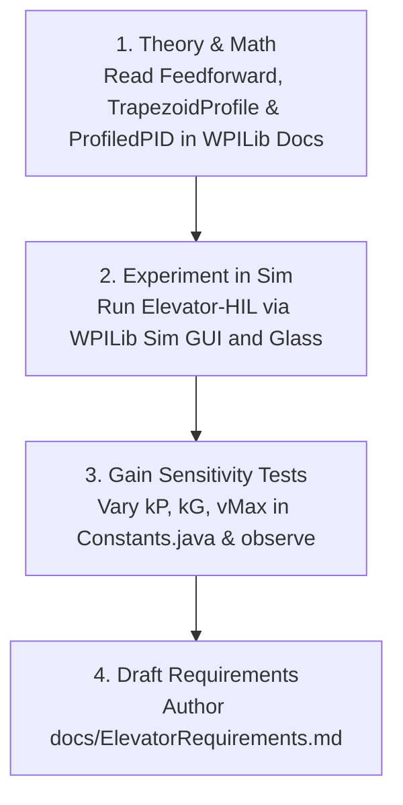

# Core Controls Reading List & Learning Roadmap

This document serves as the controls onboarding guide for the **2026-Elevator-HIL** project. It outlines the foundational WPILib concepts, reference articles, example projects, and practical steps required to design, model, and tune the elevator subsystem.

---

## 1. The Core Reading List ([docs.wpilib.org](https://docs.wpilib.org))

Read these specific articles in the WPILib Documentation under **Advanced Controls**:

### A. Why We Don't Just Use Raw PID: Feedforward
* **Article:** *Control System Basics → Introduction to DC Motor Feedforward*
* **Article:** *Feedforward in WPILib → ElevatorFeedforward*
* **Key Concepts to Learn:**
  * Standard PID is **reactive** (it only responds after a position error is observed).
  * Elevators fight gravity constantly. With standard PID alone, the elevator will either droop below its setpoint or oscillate as integral error accumulates.
  * **Feedforward ($k_G$)** is **predictive**: it injects the exact constant voltage required to counteract gravity before any error occurs, allowing the elevator carriage to hover motionless with zero PID effort.
  * $k_S$ overcomes static friction (stiction) to get the mechanism moving.
  * $k_V$ provides steady-state voltage proportional to target velocity ($V / (\text{m/s})$).
  * $k_A$ provides voltage to accelerate the mass ($V / (\text{m/s}^2)$).

---

### B. Smooth Motion: Trapezoidal Motion Profiles
* **Article:** *Trajectory & Motion Profiling → Trapezoidal Motion Profiles*
* **Key Concepts to Learn:**
  * Commanding an elevator to step from $0.0\,\text{m}$ to $1.0\,\text{m}$ instantly under standard PID will command 100% motor voltage immediately. On a cord- or belt-driven elevator, this causes high current spikes, belt slip, and can snap the lift cord.
  * A **`TrapezoidProfile`** generates a continuous, smooth path over time bounded by:
    * **$v_{\max}$:** Maximum linear velocity ($\text{m/s}$)
    * **$a_{\max}$:** Maximum linear acceleration ($\text{m/s}^2$)
  * At every time step ($20\,\text{ms}$), the profile outputs both a **position setpoint** and a **velocity setpoint**.

---

### C. Bringing Them Together: ProfiledPIDController
* **Article:** *PID Control in WPILib → Combining Feedforward and PID with ProfiledPIDController*
* **Key Concepts to Learn:**
  * `ProfiledPIDController` ties the `TrapezoidProfile` and PID loop together.
  * The velocity setpoint is fed into `ElevatorFeedforward`, while the position error is handled by PID:
    $$V_{\text{motor}} = \underbrace{\text{Feedforward}(v_{\text{profile}})}_{\text{Predictive Voltage}} + \underbrace{\text{PID}(x_{\text{profile}} - x_{\text{actual}})}_{\text{Corrective Voltage}}$$
  * In code:
    ```java
    double pidOutput = m_controller.calculate(m_encoder.getDistance());
    double feedforwardOutput = m_feedforward.calculate(m_controller.getSetpoint().velocity);
    m_motor.setVoltage(pidOutput + feedforwardOutput);
    ```

---

### D. Software Safety & Unit Conversions
* **Article:** *Basic Programming → Encoders - Software and Hardware*
* **REV Robotics Documentation:** *SPARK MAX Software Features → Soft Limits & Current Limiting*
* **Key Concepts to Learn:**
  * **Engineering Unit Conversions:** Convert raw motor rotations into linear meters using drum circumference and gear reduction:
    $$\text{Position Factor} = \frac{\pi \cdot D_{\text{drum}}}{G_{\text{gearbox}}} \quad (\text{rotations} \to \text{meters})$$
    $$\text{Velocity Factor} = \frac{\text{Position Factor}}{60.0} \quad (\text{RPM} \to \text{m/s})$$
  * **Soft Limits:** Software-enforced limit checks must evaluate both target goal and current position before voltage is applied to protect mechanical stops.
  * **Current Protection:** Configuring smart current limits ($35\text{A} - 40\text{A}$) protects the motor from burning out during binding or hard-stop impact.

---

## 2. WPILib Built-In Example Projects

To explore working code implementations in VS Code, click the **WPILib icon** (top-right) $\to$ **Create a new project** $\to$ **Example** $\to$ **Java**:

1. **`ElevatorSimulation`** *(Reference for this repository)*:
   * Demonstrates `ElevatorSim`, `ProfiledPIDController`, `ElevatorFeedforward`, and 2D mechanism visualization using `Mechanism2d`.
2. **`ElevatorProfiledPID`**:
   * Shows how to wrap an elevator subsystem in the WPILib Command-Based framework using `ProfiledPIDSubsystem`.

---

## 3. Recommended 4-Step Practical Learning Sequence



### Step 1: Study Theory & Concepts (1–2 hrs)
Read the WPILib articles above and ensure you can answer:
1. *Why is feedforward ($k_G$) essential on an elevator compared to a horizontal flywheel or drivetrain?*
2. *What physical problems occur if $a_{\max}$ is set too high?*

### Step 2: Run the Project Simulation (30 mins)
This repository contains a full Hardware-In-The-Loop / physics simulation:
1. Press `F5` in VS Code or choose **WPILib: Simulate Robot Code on Desktop**.
2. Enable **Sim GUI** and open **Glass**.
3. Under **NetworkTables $\to$ SmartDashboard**, locate **Elevator Sim**.
4. In teleoperated mode, toggle the joystick trigger to observe the elevator driving between $0.0\,\text{m}$ and $0.75\,\text{m}$.

### Step 3: Gain Sensitivity Experiments (45 mins)
Modify values in `src/main/java/frc/robot/Constants.java` and observe the physical reaction in simulation:
* Set `kElevatorkG = 0.0`: Observe how the elevator droops below the target setpoint without gravity compensation.
* Adjust constraints in `new TrapezoidProfile.Constraints(2.45, 2.45)`: Observe how reducing acceleration smooths carriage movement.

### Step 4: Write the Requirements Specification
Complete the first deliverable (`docs/ElevatorRequirements.md`) with:
* Height presets in meters (Stow, Low/Intake, Mid, High).
* Kinematic limits ($v_{\max}$ and $a_{\max}$).
* Current limits ($35\text{A}$ continuous, $40\text{A}$ peak) and soft limits.
* State machine transitions matching `docs/UML_DIAGRAMS.md`.

