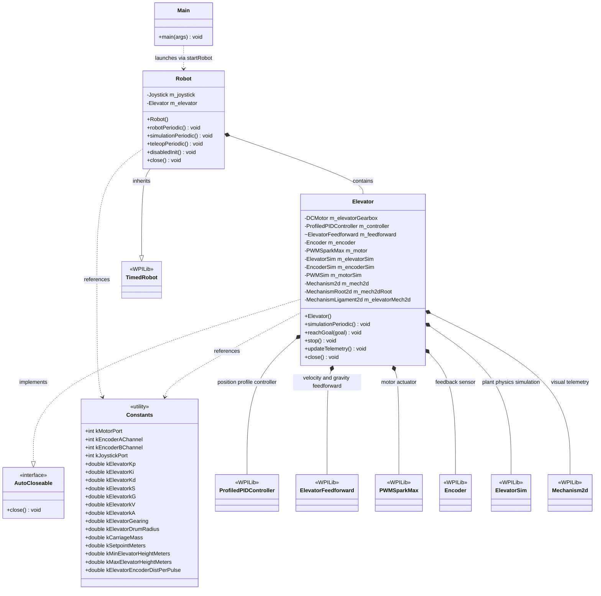
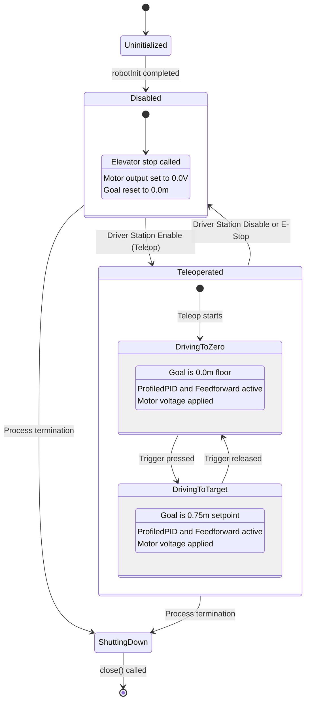
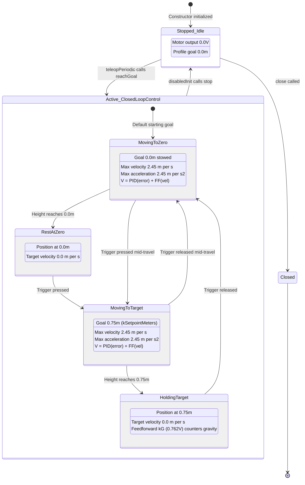
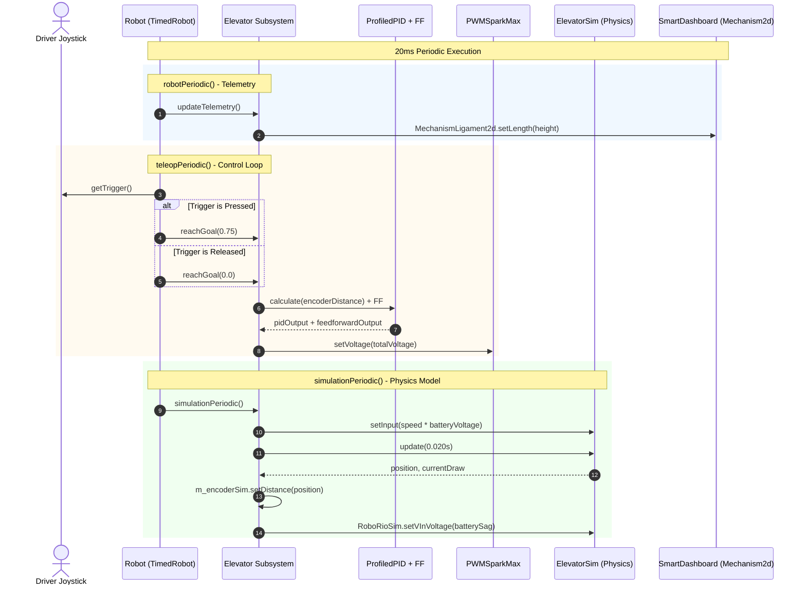

# Elevator HIL - UML Diagrams

This document contains standard, syntax-verified Mermaid UML diagrams for the **2026-Elevator-HIL** WPILib project.

---

## 1. Class Structure Diagram

---

## 2. Robot Mode Lifecycle State Machine

---

## 3. Elevator Operational State Machine

---

## 4. Control Loop & Simulation Sequence Diagram

